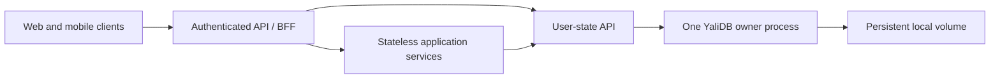

# YaliDB technical specification

**Version:** 0.4 — implementation contract; production release gates outstanding
**Date:** 2026-10-23
**Input:** [PRD v1.0](yalidb-prd.md). This document governs the initial implementation where it differs from the earlier PRD. Implementation status and release blockers are tracked in [production readiness](docs/production-readiness.md). This is not a production-readiness certification.

## 1. Recommendation

Build a Rust embedded engine with durable byte-key operations and TTL, plus an optional small HTTP service. For a single host running several services in different languages, run **one YaliDB owner process per database**, accessed through HTTP. Make the web/mobile-facing application tier stateless by moving its persistent state into that owner process.

**Confirmed owner intent:** build a new storage engine, develop Rust fluency from beginner through intermediate/advanced, and release an open-source database the community can consume. Learning and database quality have equal priority. Implement the append-only design below; SQLite and redb are comparison baselines rather than replacement implementations.

Rust is the selected implementation language for this direction, not a guarantee of the smallest artifact or best throughput. Prove the footprint and workload advantage before claiming it. Learning milestones can be exploratory; released durability, correctness, and compatibility contracts must be explicit and supported by evidence. Keep the first release narrow enough that both goals are achievable.

Distributed applications can use a single remote YaliDB service before the database has replication. That enables application scaling but leaves a storage availability bottleneck. Treat a replicated database as a separate future product stage with its own requirements and failure tests.

## 2. PRD review and proposed corrections

The narrow byte-KV API, conservative durability, expiry, and embedded-first packaging are good foundations. The following changes should precede a v1 commitment:

1. **Correct §10's sticky-session claim.** Separate local databases on each application host need affinity or explicit ownership routing. Multiple application instances accessing one shared YaliDB service do not. A stateful storage tier is compatible with a stateless application tier; stateless does not mean that the whole system has no state.
2. **Replace competitive absolutes with hypotheses.** SQLite is a credible local application-state store; a primary database may be the simplest choice when already operated and comfortably provisioned. A separate YaliDB service still needs deployment, monitoring, backups, and security. Redis offers configurable persistence, including fsync-before-reply; durability is not exclusive to YaliDB. See [SQLite use cases](https://www.sqlite.org/whentouse.html) and [Redis persistence](https://redis.io/docs/latest/management/persistence/).
3. **Resolve “single-file” versus rotation.** Adopt one database directory containing several managed files. Promise a simple path and a consistent export, rather than exactly one physical file during operation. This is a proposed PRD change.
4. **Define RAM by cardinality.** A keydir stores each key and metadata in memory. Low idle RSS for an empty database says little about a million keys. Publish bytes per live key as well as empty-process RSS.
5. **Add conditional writes to P0.** Concurrent devices can lose favorites or settings updates under unconditional get/modify/put. Return versions and support compare-and-swap (CAS). Cross-key transactions remain out of scope.
6. **Narrow expiry's “never resurrected” guarantee.** Old overwritten versions must never reappear, including after compaction. Absolute TTL also needs a clock policy; wall-clock rollback across restart can make an expired-but-not-yet-purged record appear live unless extra machinery prevents it.
7. **Strengthen durability acceptance.** Five kill tests do not establish a durable database. Process death, OS failure, power loss, checksum corruption, and device loss are different cases. A checksum mismatch does not prove a harmless torn write.
8. **Separate data classes.** UI preferences and resumable cursors fit the scope. Favorites may be valuable business data needing backups and export. OTPs, auth sessions, quotas, and payments need additional security or atomicity guarantees; omit them from v1 examples. A cursor alone does not guarantee exactly-once event processing or consistency with another database.
9. **Move basic diagnostics earlier.** Health, disk usage, queue saturation, recovery failures, and sync latency are needed when the sidecar ships, rather than being optional later polish.

## 3. Scope and deployment

### Embedded mode

One process owns a local database directory and an exclusive OS file lock for its lifetime. Threads share a database handle. A second process opening that directory fails clearly. All participants must cooperate with this lock; direct edits are unsupported. Use a local persistent filesystem; exclude NFS/SMB and ephemeral container layers from v1 durability claims.

### Single-host microservices — recommended service mode



The user-state API and YaliDB service can be one Rust executable. Alternatively, the domain API can be Node, Python, Go, Java, or another language calling the generic YaliDB HTTP service. Choose one canonical ownership path; do not let every service mutate arbitrary user keys.

Loopback TCP works for processes on one host. In separate containers, localhost refers to each container: use a private container network or a deliberately configured shared network namespace. Unix sockets can follow later if measurements justify another transport. An orchestrator “sidecar per app replica” creates independent databases and does not provide shared state.

Clients authenticate to the application API. That API derives tenant/user identity from the authenticated principal and authorizes each operation. Browser and mobile clients never receive generic database credentials or choose arbitrary storage keys. State survives app restarts and device changes because the same identity maps to the same server-side records.

The storage process is still stateful. Host or volume failure causes downtime; independent backups are required for permanent data. Stateless frontends do not change this failure boundary.

## 4. Language and engine choices

**Rust — recommended for the engine.** Ownership supports memory safety without garbage collection, useful for explicit buffer ownership and controlled memory use ([Rust ownership documentation](https://doc.rust-lang.org/stable/nomicon/ownership.html)). Safe Rust does not prevent incorrect sync ordering, lost updates, deadlocks, excessive allocation, or storage corruption. HTTP/runtime dependencies may dominate a small server's binary size. Keep them optional.

**Go — credible service-first alternative.** Prefer it if implementation speed and team fluency dominate. Evaluate its runtime and GC behavior with this workload rather than assuming they disqualify it. It is a less natural fit when the principal deliverable is a native library embedded into varied host runtimes.

**C/C++ — viable with expertise, unnecessary initial risk here.** Explicit control and native integration are attractive, but manual memory safety raises the engineering burden for a new engine. Rust FFI would also introduce an unsafe boundary, so defer native bindings.

**Existing engines — comparison baselines.** SQLite already targets local application storage. [redb](https://github.com/cberner/redb) is an existing Rust transactional KV engine. Compare both with identical durability and TTL semantics before selecting custom storage for production. Their feature sets do not make them inherently too large for this workload.

Suggested packages: `yalidb-core` for synchronous storage and no HTTP/runtime dependency; `yalidb-server` for the optional service; a small admin CLI for offline verification and export. Do not build a pluggable storage framework before there are demonstrated needs.

## 5. API and consistency contract

Proposed conceptual API, not compiled Rust signatures:

```text
open(directory) -> Db
get(key) -> Missing | Entry { value, version, expires_at }
put(key, value, ttl?, condition = Any | Absent | Version(v)) -> version
delete(key, condition = Any | Version(v)) -> outcome
scan_prefix(prefix, after_key?, limit) -> entries + next_key
close() -> result
```

Keys and values are opaque bytes. Initial proposed limits: nonempty keys up to 1 KiB, values up to 64 KiB, scan pages up to 100 entries and 1 MiB. Validate lengths before allocation, including on recovery. Empty values are valid. Reject zero/negative TTL; omission means permanent and a replacement without TTL clears the previous TTL. These limits are defaults for discussion, not measured optimums.

Each operation is atomic and linearizable within the single owner. A writer serializes condition checks, log appends, and publication. Readers see committed versions only. A later overwrite or expiry can legitimately change a previously acknowledged value. No multi-key atomicity or transaction across YaliDB and a business database is implied.

Use a persisted monotonically increasing mutation sequence as the record version, including deletions; preserve its high-water mark through compaction and restart. Never reuse an old version after deletion/recreation. CAS compares the current live version under writer serialization; conflicts do not write. An expired key is absent. Sequence exhaustion produces an error rather than wrapping.

For concurrent favorites updates, read version, modify the list, conditionally write, then re-read and merge on conflict. Last-writer-wins is acceptable only when explicitly chosen. For monotonic cursors, a domain API must validate a defined cursor ordering; opaque event IDs cannot be compared generically.

Prefix scans are byte-lexicographic, bounded pages with keyset continuation, and weakly consistent across pages. Changes may be missed or observed between pages. They are not a backup mechanism. The implementation uses a hash keydir and retains at most `limit + 1` candidate keys. Traversal visits the whole index; bounded sorted-vector selection adds up to O(limit) work per eligible key. Add an ordered index only after measuring its RAM tradeoff. Empty prefixes are valid; empty continuation keys are invalid. The count limit is 1–100; returned key+value bytes are capped at 1 MiB, excluding metadata.

## 6. HTTP contract and language integration

Use versioned HTTP/1.1 with persistent connections. Hyper/Tokio now enforces bounded connections/queues, deadlines, and graceful shutdown; [the HTTP resource contract](docs/http-hardening.md) and [OpenAPI](docs/openapi.json) specify the implementation limits. JSON envelopes encode keys/values as base64url; decimal-string versions avoid JavaScript integer precision loss. Initial routes:

```text
POST /v1/get     { key }
POST /v1/put     { key, value, ttl_ms?, condition? }
POST /v1/delete  { key, condition? }
POST /v1/scan    { prefix, after_key?, limit? }
GET  /health/live
GET  /health/ready
```

POST lookups keep potentially sensitive keys out of ordinary URL logs. Return explicit `found` with successful get responses, including absent keys. Use 400 for malformed input, 409 for condition conflicts, 413 for oversized requests, 429 for bounded-queue overload, and 503 for unavailable storage. A timeout or connection loss after sending a mutation has an **unknown outcome**; it must not be reported as proof that the mutation failed.

Put success means durable commit. Return the new version and absolute expiry. Values and keys are never logged. Bind to loopback by default; private-network access requires deliberate configuration and service credentials. Use TLS or mTLS across untrusted networks; network location alone is not authorization. Enforce request size, connection, and queue limits and protect diagnostics endpoints.

Every language can use its standard HTTP client; native SDKs are optional convenience wrappers. First ship documented curl, Node, Python, and Go examples using the same wire contract, keep-alive, explicit timeouts, and CAS handling. Never open the same database file through different language libraries or processes.

Do not automatically retry writes on ambiguous transport failure: even an identical put can extend a relative TTL or overwrite a newer value. CAS can make some retries safe against overwrites but cannot prove which client committed a version. Durable request-ID deduplication is a future feature with explicit retention semantics.

## 7. Storage layout and commit protocol

The implementation contract is specified byte-for-byte in [format v1](docs/storage-format.md). Use one selected generation log, a fixed-size checksummed manifest selecting it, and a stable lock file. The log begins with a compacted snapshot and mutation high-water mark, followed by strictly ordered appends. The hash keydir contains owned keys and record offsets/metadata; values stay on disk. The in-memory API is a separate volatile evaluation mode and keeps values in RAM.

This deliberately simplifies the earlier multi-segment proposal: rotation and compaction are one whole-generation rewrite. The tradeoff is pauses and up to two keydirs plus sorted key references during maintenance. Reads/writes/maintenance share one mutex, so there are no in-flight readers of retired generations. `Db` clones share the owner; the OS file lock lives until the last clone is dropped. A poisoned mutex or integrity/I/O error blocks subsequent data operations. Diagnostics remain available after ordinary storage errors.

Commit ordering:

1. Serialize the operation; validate input, sample effective time once, and check conditions.
2. Check deadline/sequence arithmetic and admission limits before modifying user state.
3. Complete any required compaction, append a fully checksummed frame, and call `sync_all` on the log.
4. Publish the index and high-water mark, then return success.

Creation/publication additionally synchronizes the containing directories. This is implemented through Rust's safe filesystem API; durability depends on OS/device flush semantics. Linux is the initial deployment target; macOS is a development/evaluation platform pending explicit power-loss/flush validation. No Windows or network-filesystem support is claimed. See [Rust File API](https://doc.rust-lang.org/std/fs/struct.File.html) and [SQLite atomic commit](https://www.sqlite.org/atomiccommit.html).

Write/sync errors have an unknown outcome. The owner becomes unhealthy; all handles must be dropped before reopening. Recovered complete frames, including potentially unacknowledged ones, are synchronized before becoming visible. No at-most-once retry guarantee is provided. There is no explicit close API: each successful mutation has already flushed, and dropping every clone releases ownership. A backup requires stopping all writers and dropping all handles.

### Recovery and corruption

Validate manifest/header checksums and the bounded snapshot count. Replay snapshot records with unique keys and strictly increasing original versions no greater than the header high-water mark; then replay mutations with contiguous sequences. Tombstones remove prior entries, and expired records remain indexed until maintenance so they cannot reveal older versions.

Only an incomplete append tail is automatically truncated, and that truncation is synchronized. A complete invalid frame, malformed length/header, CRC mismatch, incomplete snapshot, missing manifest in a nonempty database, or invalid sequence fails closed. The frame's length is independently checksummed before allocating or classifying a partial body. Reads revalidate record checksums and index identity.

Arbitrary removal of acknowledged bytes from the tail cannot be distinguished from an incomplete unacknowledged append. The durability claim excludes media damage, external modification, broken flush implementations, and deletion/truncation of files; use independent backups. Offline salvage is manual investigation of a preserved copy, not an implemented repair command. Never advise automatic deletion of damaged files.

### Generation replacement and reclamation

Under the owner mutex, collect live records in increasing version order and stream their values into a fresh generation. Preserve expiry, original versions, and the mutation high-water mark even if no live keys remain. Synchronize the new file and directory; write/flush `MANIFEST.tmp`; atomically rename it over `MANIFEST`; synchronize the directory. Only then change the in-memory owner and remove old generations. A failure after publication poisons the owner rather than letting it serve an inconsistent index.

Recovery adopts only the manifest-selected generation. After validating/replaying it, remove recognized orphan generations and temporary manifests; never infer current state from the newest filename. If first-time initialization is interrupted before any manifest exists, a nonempty directory fails closed and requires investigation. No operation could have been acknowledged in that initialization window.

Defaults: 100,000 indexed keys, 64 MiB selected log, and consideration of compaction after 8 MiB when selected history is more than twice the indexed record bytes. Reaching the log cap also triggers compaction. Puts reserve 1,065 bytes for a maximum-size tombstone; deletes can use that reserve and reclaim earlier tombstones on the next compaction. A live dataset that does not fit is rejected with a capacity error. Options are explicit, validated, and also enforced on recovery; lowering them can prevent reopen. The database never evicts live data to satisfy a limit.

These are conservative initial admission defaults, not measured capacity recommendations. Provision at least twice the selected-log cap plus filesystem/metadata margin. ENOSPC or other I/O failure can occur despite logical headroom; poison and reopen after restoring space. The log cap does not include compaction workspace or filesystem overhead. Cleanup after successful recovery prevents accumulating recognized orphan generations. Stop-the-world compaction pauses must be measured before production use.

## 8. TTL and resource policy

Persist absolute UTC expiry computed at commit; do not restart TTL during recovery. A read whose sampled effective time is at or past expiry returns absent. Use a clock abstraction and nondecreasing effective wall time within a process. Lazy expiry determines visibility. In-memory `purge_expired` removes invisible entries; disk-backed purge uses generation compaction so index admission remains valid on replay. There is no background maintenance thread in the initial core; the owner explicitly schedules purge/compaction as needed. Preserve latest-version semantics and the sequence high-water mark.

Proposed v1 boundary: assume a reasonably maintained host clock; forward jumps can expire records early, and rollback across restart can extend visibility for records not durably removed. Document this rather than claiming strict non-resurrection under arbitrary time changes. Strict expiry across rollback needs a persisted time floor or durable expiry decisions and additional write/failure semantics. Do not use this TTL contract for security-critical validity decisions.

Measure idle RSS, bytes per indexed key, value-read allocation, active-request buffers, binary size, recovery time, compaction headroom, and worst maintenance pause. Proposed evaluation points: 10k, 100k, and 1m live keys; values of 64 B, 1 KiB, and 16 KiB; mixed expiry and hot-key churn. These are test workloads, not capacity promises. Add explicit disk/key-count limits and bounded admission so “small footprint” includes overload behavior.

## 9. Backup, observability, and failure behavior

Initial backup is offline: close the owner cleanly and copy the complete database directory to independent storage. Verify and restore it in tests. A normal copy of files during writes/compaction is not a supported snapshot. Later add a pinned-segment snapshot/export protocol. Backups should preserve expiry and versions; restoring old backups explicitly rolls back state.

Report record count, indexed key bytes, segment bytes, pending queue length, read/write/sync latency, expired-read count, recovery time, and compaction duration/failures. Readiness means recovery and lock acquisition completed and storage is healthy. Liveness should not restart a healthy process merely because it is overloaded. Never expose user data through metrics labels.

On state-service failure, UI preferences may fall back to defaults if the product allows it; persistent favorites should return a clear unavailable response. A stream cursor fallback depends on whether replay causes duplicate work and how the application handles it. Do not silently acknowledge failed persistence.

## 10. Multi-node exploration

**Stage A — many applications, one storage node.** Application services on multiple hosts call one private YaliDB endpoint. No affinity needed. Local engine consistency remains intact; network latency and a single storage failure domain are the costs. This is a multi-node application architecture, not a distributed database. The localhost-only PRD boundary would need an explicit deployment/security amendment.

**Stage B — partitioned ownership.** Route each user/tenant to one YaliDB owner. This can spread capacity, but does not supply failover. Avoid automatic hash-ring membership changes: moving users requires coordinated copy/catch-up, ownership fencing, and routing epochs. A fixed, manually managed partition map is easier to reason about, but still carries operational burden. Do not use two independent writers for the same partition.

**Stage C — asynchronous standby.** Replicate sequence-tagged committed mutations and snapshots. State the nonzero recovery point objective: acknowledged local writes can be lost on promotion. Require fencing before promotion; replication alone does not prevent split brain. Backups and asynchronous copies are not quorum durability.

**Stage D — replicated database, separate RFC/PRD.** Use one three-voter consensus group before considering sharding. A consensus algorithm such as Raft orders a replicated state machine; a majority permits progress despite a minority failure ([Raft paper](https://raft.github.io/raft.pdf)). Define durable quorum acknowledgment and apply-before-response, leader fencing, linearizable read barriers, snapshot install, membership changes, retry deduplication, and disaster recovery. Two voters cannot maintain quorum after losing one.

TTL becomes part of replicated semantics: replicate leader-chosen absolute timestamps and explicit expiry commands, and define how linearizable reads observe expiry. Followers must not make divergent state-machine decisions from independent local clocks. CAS, sequence assignment, expiry, deduplication, and snapshot metadata must all remain deterministic. Specify the Raft-log/state-machine persistence relationship and last-applied index to prevent double application on restart. Reusing the single-node append log without this design is unsafe.

For strong shared state, a partitioned minority must reject or defer operations. We cannot promise both always-available writes and one authoritative linearizable value during a network partition. Prefer migrating to an existing replicated store if these requirements arise before YaliDB has sufficient operational maturity.

Useful preparation now: explicit mutation commands, versions, clock injection, format versioning, and snapshot boundaries. Defer elections, gossip, consensus dependencies, and custom replication until there is a concrete requirement.

## 11. Implementation and validation plan

**Phase 0 — define the workload and measurement baseline.** Define target host, dataset size, key sizes, expected concurrency, durability, backup expectations, and acceptable unavailability. Establish a reusable benchmark contract and a minimal SQLite baseline; add redb before publishing comparative claims. Baseline work must not block the first in-memory Rust learning milestone. The custom-engine decision is settled; measurements guide its scope and honest positioning.

**Phase 1 — API semantics.** Implement in-memory operations, injected clock, version allocation, conditional writes, bounds, concurrent-operation history checks, and documented scan semantics. No durability claims yet.

**Phase 2 — durable append and recovery.** Specify format, locking, sync ordering, rotation, explicit corruption failures, and fault injection around every persistence boundary. Use a reference model to compare recovered state with acknowledged operation histories. Test incomplete headers/payloads, corrupted metadata, partial writes, ENOSPC, sync errors, and unknown versions.

**Phase 3 — bounded maintenance.** Implement compaction/expiry sweep, crash tests at each manifest installation step, backup/restore, sequence preservation after deletion/expiry, and stress tests with concurrent readers and mutations. Validate no overwritten/expired history is resurrected.

**Phase 4 — cross-language service.** Publish OpenAPI, examples, auth, limits, readiness, and metrics. Exercise simultaneous Node/Python clients updating one user, ambiguous responses, reconnects, queue saturation, and graceful shutdown. Graceful shutdown is helpful but never necessary for correctness.

**Phase 5 — release gate.** Fuzz record/manifest parsers with bounded allocation. Run randomized process-kill workloads over many seeds; separately inject storage failures that model unsynced-write loss and reordering. kill -9 alone leaves the kernel/page cache alive and does not simulate power failure. SQLite's [testing approach](https://www.sqlite.org/testing.html) is a useful reference for this distinction. Enforce safe Rust in core source; audit dependencies separately because that rule does not imply all transitive code contains no unsafe.

Benchmark embedded and HTTP modes separately, using identical durability, record counts, access distribution, contention, and expiry policy for each baseline. Report p50/p95/p99 and achieved throughput at stated offered load; separate warm/cold reads, durable write latency, recovery, and compaction pauses. Include sync calls, peak RSS, binary increment, disk/write amplification, and filesystem/hardware/compiler details. Use SQLite WAL with FULL synchronous durability as a stated baseline, and document checkpoint policy. Avoid comparing YaliDB durable writes with a baseline's weaker settings or hiding overload through closed-loop measurements alone.

Keep the PRD's sub-millisecond embedded-read number as a hypothesis. Define numeric footprint, recovery, and pause budgets after Phase 0; do not publish invented benchmark results. Initial platform target: Linux x86-64/ARM64 on local SSD; macOS development support requires separately tested flush behavior. Windows can follow explicit filesystem/locking validation.

## 12. Rust learning and open-source release discipline

Learn the language through the engine in small, reviewable steps. Each step should include a short explanation of the invariant, focused exercises or implementation work, and tests that demonstrate behavior. Avoid introducing async execution, unsafe code, lock-free structures, or elaborate abstractions before the synchronous engine works.

1. **In-memory KV:** ownership, borrowing, slices, `Vec<u8>`, collections, structs, enums, `Option`, `Result`, modules, and unit tests. Understand why returned values initially own their bytes.
2. **Record codec and append log:** byte layouts, checked arithmetic, I/O traits, error propagation, buffered versus durable writes, and integration tests. Explain every persisted field and failure boundary.
3. **Recovery and TTL:** injected dependencies, explicit state machines, reference-model testing, clock semantics, fuzzing, and corruption classification.
4. **Shared handles and CAS:** `Arc`, locks, thread safety, `Send`/`Sync`, lock ordering, and operation linearization points. Begin with coarse locking and establish correctness before reducing contention.
5. **Compaction and backup:** RAII, file/reader lifetimes, crash-safe publication, disk headroom, and failure injection. Distinguish memory safety from persistence correctness.
6. **HTTP and packaging:** async fundamentals at the service boundary, blocking work isolation, cancellation and ambiguous outcomes, feature flags, public API documentation, and interoperability tests.

Advanced proficiency should emerge from reasoning about these constraints, profiling, and explaining tradeoffs. It does not require adding unsafe code or distributed consensus to v1.

Open-source the work early with an explicit experimental status. Before inviting contributions, provide the intended dual MIT/Apache-2.0 license, a runnable quickstart, architecture notes, contribution guidance, and a security-reporting policy. Tag releases and record known limitations. Do not describe an experimental build as suitable for irreplaceable data.

Use three evidence-based release stages:

- **Experimental:** a readable implementation and reproducible examples; format and API may change with notice; evaluation and learning use only.
- **Alpha/beta:** complete supported single-node semantics, automated fault tests, documented backup/restore, resource limits, example clients, and published benchmark methodology. Recruit opt-in evaluators with recoverable data and solicit failure reports.
- **v1:** pass Phase 5, publish actual results and supported-platform assumptions, validate migrations from supported prereleases or explicitly require export/import, test restoration, and document operational procedures. A version number alone is not evidence of production readiness; state residual risks and maintain the failure-test suite as the engine evolves.

Performance or footprint claims can be modest. Correctness, recoverability, understandable behavior, and usable documentation are release requirements even if YaliDB does not beat an incumbent. Community feedback can change scope without weakening the durability contract.

## 13. Remaining design decisions

Confirmed direction: a custom Rust engine with equal emphasis on learning and community usability. Proposed architectural defaults remain embedded core plus one shared optional HTTP owner; single-host first; directory-based storage; P0 CAS; no automatic failover; Linux-first durability validation.

Initial deployment contract: one host/one persistent owner; no automatic failover. An acknowledged successful mutation must survive process death on supported storage. Host/volume loss has no availability or recovery-point guarantee; backup frequency and restore time are operator-defined and must be validated for the application. Workload sizing and performance budgets must be recorded before a production approval. The HTTP adapter now implements bounded connections/queues/deadlines and network tests; it remains experimental pending independent security review, prolonged overload measurements and platform validation. A [trace-driven power-loss model](docs/power-loss-testing.md) now reconstructs crash cases from actual storage operations; real Linux storage validation remains outstanding. See [the release checklist](docs/production-readiness.md) for required evidence. The older PRD describes product intent; this specification controls the concrete engine contract.
